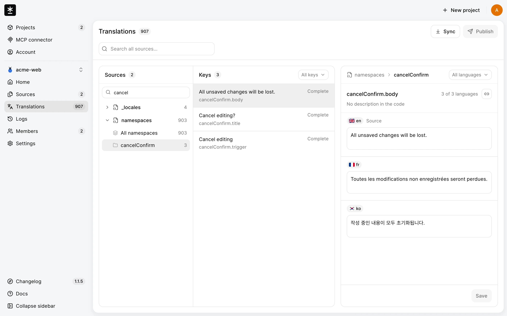
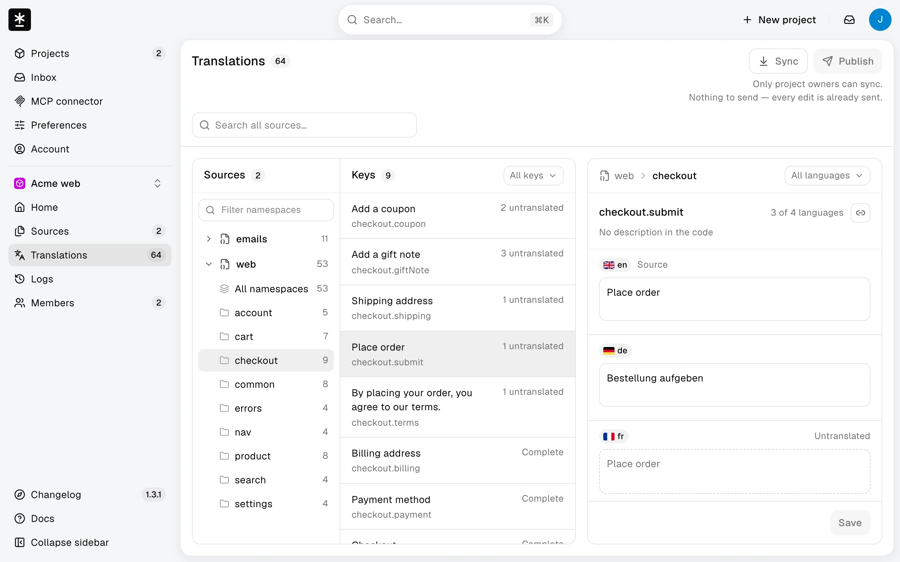
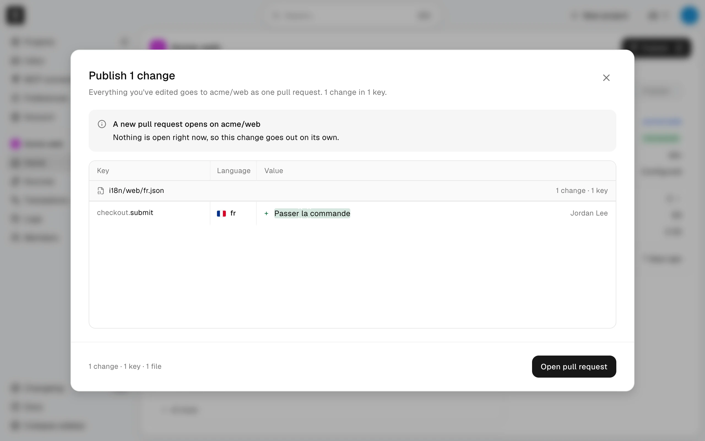
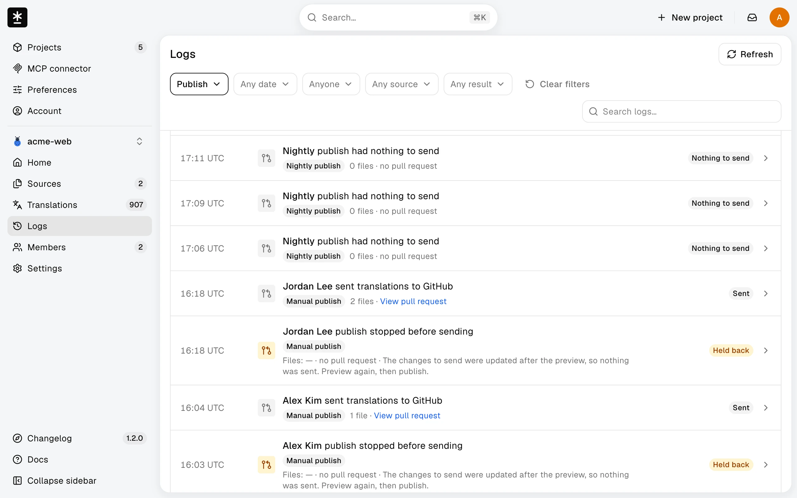
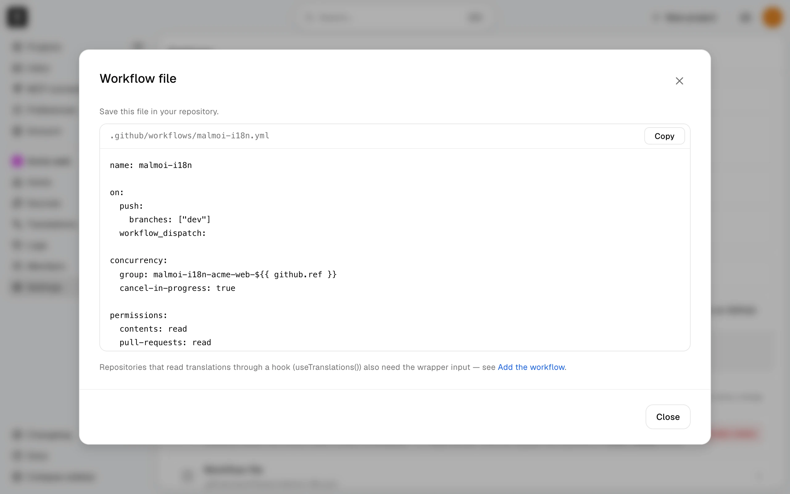

<h1 align="center">
  <a href="https://mal-moi.com"><picture><source media="(prefers-color-scheme: dark)" srcset="public/brand/malmoi-icon-white.svg" /></picture></a><br/>
  Malmoi
</h1>

<p align="center">
  <a href="https://github.com/SinhyeokKang/malmoi/releases/latest"></a>
  <a href="LICENSE"></a>
  
  <a href="https://mal-moi.com/docs/ai-agents"></a>
  <a href="https://mal-moi.com/docs/self-hosting"></a>
</p>

<p align="center">
  <strong>Connect your projects, translate &amp; ship together.</strong><br/>
  Malmoi is a localization tool for GitHub or GitLab repositories. It finds the translation files already in your repo,
  lets teammates edit them in the browser, and sends every change back as one pull request.
  Coding agents can do the same work over MCP — sign in through your browser, no token to copy.
</p>

<h3 align="center"><a href="https://mal-moi.com"><ins>Get started</ins></a> · <a href="https://mal-moi.com/docs">Read the docs</a></h3>

<p>
  
</p>

Translators never touch Git: they sign in, edit, and hit **Publish**.

## How it works

```text
   push to the base branch (GitHub Actions / GitLab CI) or nightly
  Repository  ──────────────────────────────────────────────▶  Malmoi
  decides which keys exist                         teammates edit values
      ▲                                                          │
      │   one pull request / merge request (Publish or nightly)  │
      └──────────────────────────────────────────────────────────┘
```

Connect a repository and Malmoi detects and loads its translation files. New
commits come in nightly, or on every push with the generated workflow;
**Publish** sends saved edits back as one pull request. The two sides are never
merged — the repository decides which keys exist, Malmoi holds the values.
GitLab.com works the same way, with a personal access token and a merge request.

[Create your first project →](https://mal-moi.com/docs/create)

## Features

<table>
<tr>
<td width="50%" valign="middle">

### Find, then edit

A source tree and key list on one side, the selected key in every language on
the other. Search covers key names, source text, and translations.

</td>
<td width="50%">
  
</td>
</tr>
<tr>
<td width="50%" valign="middle">

### Preview every change before it's sent

Publish lists each key × language change before writing anything, and never
writes to the base branch — merging stays with your reviewers.

</td>
<td width="50%">
  
</td>
</tr>
<tr>
<td width="50%" valign="middle">

### Every change, on the record

Logs records edits, syncs, and publishes — who did what, with translation
values before and after — for the life of the project.

</td>
<td width="50%">
  
</td>
</tr>
<tr>
<td width="50%" valign="middle">

### One workflow file

A generated GitHub Actions workflow (or GitLab CI job) brings new keys in on
every push, flags translations whose source changed as **Needs review**, and
shows where your code uses each key.

</td>
<td width="50%">
  
</td>
</tr>
</table>

- **Unsent edits are safe** — while edits are unpublished or a Malmoi pull
  request is open, repository updates wait instead of overwriting them.
- **Add or remove languages** — Publish creates or deletes the file; removed
  translations come back if you add the language again
  ([details](https://mal-moi.com/docs/setup/languages)).
- **Nothing is deleted** — keys removed from code keep their translations.
- **Two roles** — owners manage settings and members; editors translate and publish.
- **AI agents over MCP** — connect Claude Code, Codex, or claude.ai and sign in
  through your browser; agents can do only what you can. Malmoi itself never
  calls an AI model ([details](https://mal-moi.com/docs/ai-agents)).
- **English, Korean, or Spanish**, light or dark — interface and docs.

## Supported file formats

| Format | Example path |
| --- | --- |
| JSON catalog | `src/locales/{locale}.json` |
| YAML catalog | `config/locales/{locale}.yml` |
| Chrome extension messages | `_locales/{locale}/messages.json` |
| Code dictionary, one file per language | `src/locales/{locale}.ts` |
| Code dictionary, all languages in one file | `src/i18n/namespaces/*.ts` |
| Flutter ARB | `lib/l10n/app_{locale}.arb` |
| Apple strings file | `ios/App/{locale}.lproj/Localizable.strings` |
| Apple String Catalog | `ios/App/Localizable.xcstrings` |
| Android strings file | `app/src/main/res/values-{locale}/strings.xml` |

Publish keeps each file's layout — comments, blank lines, key order,
indentation, encoding — as far as the format allows. Plurals (ICU, `.stringsdict`,
Android `<plurals>`) are kept but not edited. One project can mix several
sources and formats. Format-specific rules — such as Android's base language
and inline tags — are in the [format reference](https://mal-moi.com/docs/reference/formats);
size caps are in [Limits](https://mal-moi.com/docs/reference/limits).

## What Malmoi doesn't do

Malmoi is a pipeline between your repository and your team, not a translation
platform. By design, it has no translation memory or machine/AI translation,
no ICU plural editing, no approval workflows or fine-grained permissions, and
no real-time co-editing, in-context editing, screenshots, or translator notes.
If you need those, a platform such as Crowdin or Tolgee is a better fit.

## Under the hood

**Exports are deterministic.** The same data and original files produce
byte-identical files, so Publish commits only the files that actually changed.

**On GitHub, commits come from the GitHub App, not from people,** so a
translator leaving the organization doesn't break the pipeline. GitLab writes
as the person whose token the project uses.

More in [`docs/ARCHITECTURE.md`](docs/ARCHITECTURE.md) (Korean).

## Self-hosting

Use mal-moi.com, or run the same app on one Linux server with Docker Compose
(app, PostgreSQL 17, a nightly scheduler, behind your HTTPS proxy). Every
release publishes `ghcr.io/sinhyeokkang/malmoi:v<x.y.z>`. You bring the OAuth
apps for sign-in, a Resend domain for invitations, and optionally a GitHub App
to connect GitHub repositories. Kubernetes, multiple instances, GitHub
Enterprise, and GitLab Self-Managed aren't supported.
[Self-hosting guide →](https://mal-moi.com/docs/self-hosting)

## Privacy

mal-moi.com sends data only to GitHub, GitLab and Google (if you use them),
Supabase (database, Tokyo), Vercel (hosting, pictures, cookieless page-view
counts), and Resend (invitation emails). A self-hosted installation uses the
operator's own server instead of Supabase and Vercel, and its privacy policy is
the operator's own.
[Full policy →](https://mal-moi.com/privacy)

## Development

```bash
nvm use            # Node 24
pnpm install
cp .env.example .env.local   # fill in the values
pnpm db:generate
pnpm dev
```

Commands and conventions are in [`CLAUDE.md`](CLAUDE.md) (Korean, also the
agent instructions); product scope is in [`docs/PRODUCT.md`](docs/PRODUCT.md).
The engineering docs and source comments are in Korean — the project is built
by one person, and that's the language it was thought in.

## License

[MIT](LICENSE) © 2026 Sinhyeok Kang
